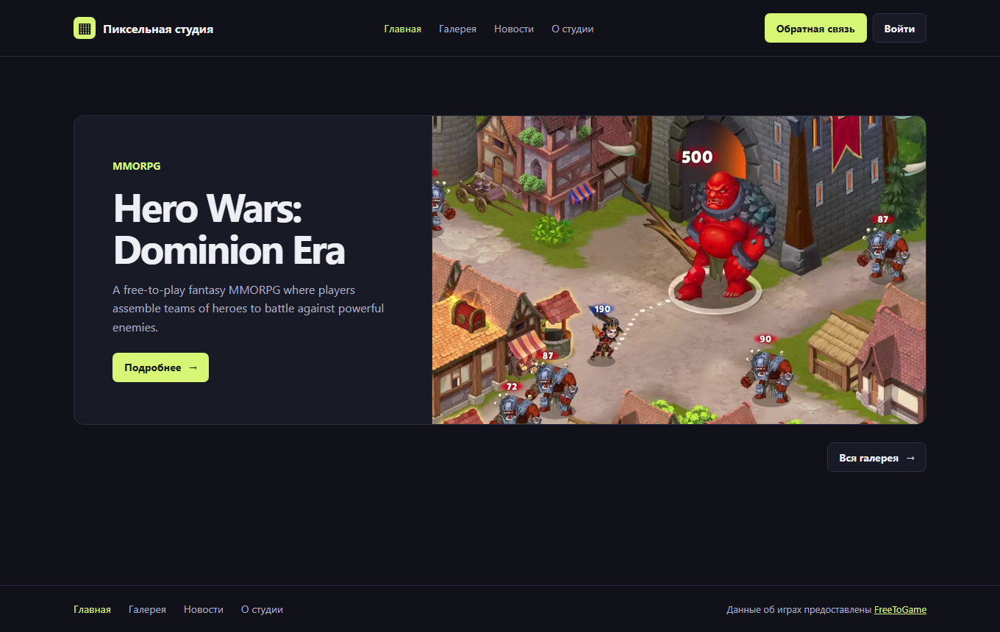
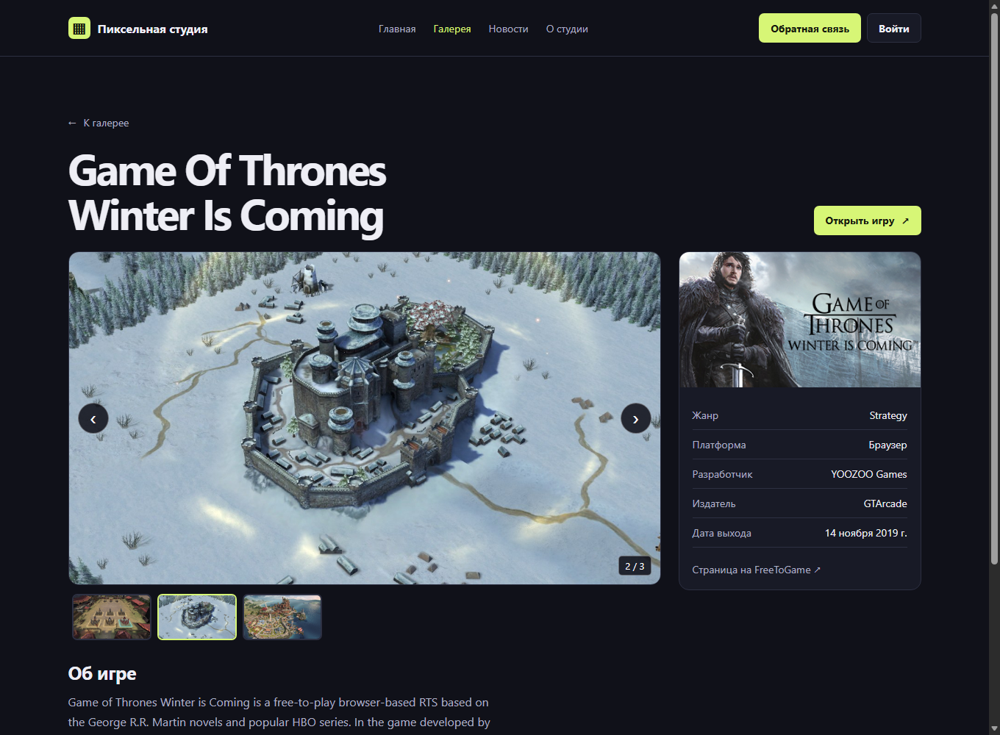
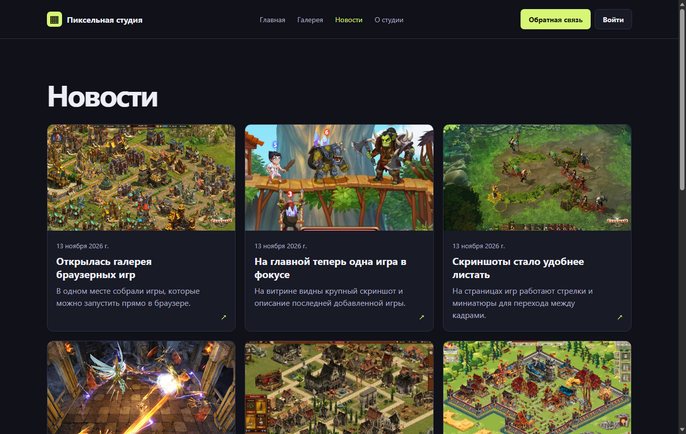
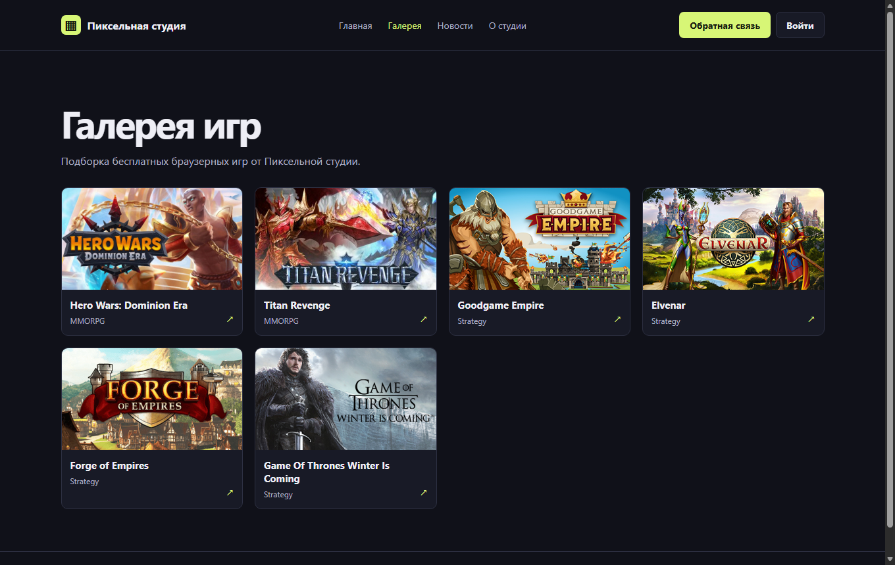
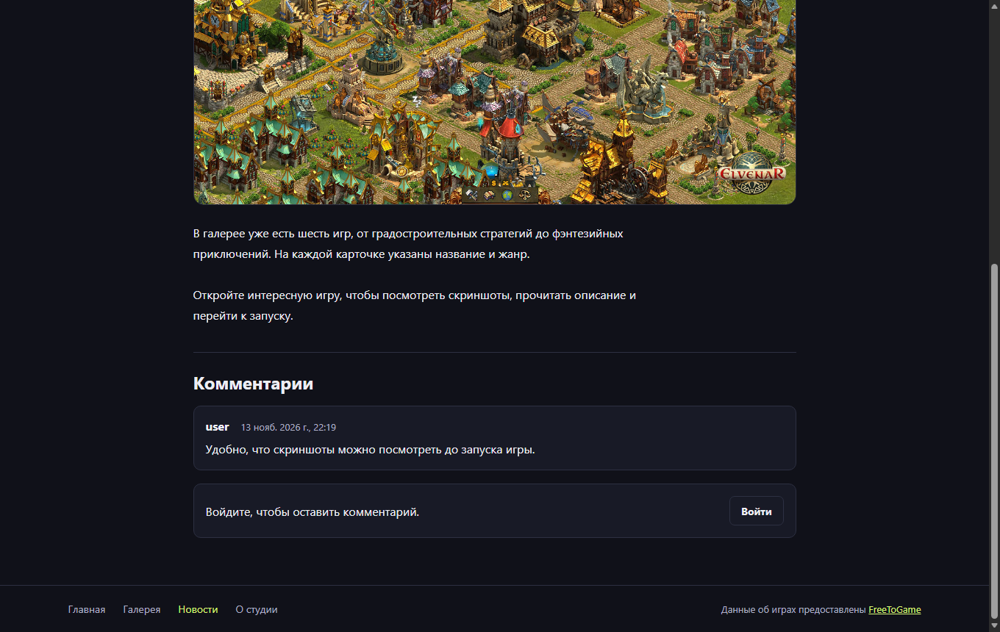
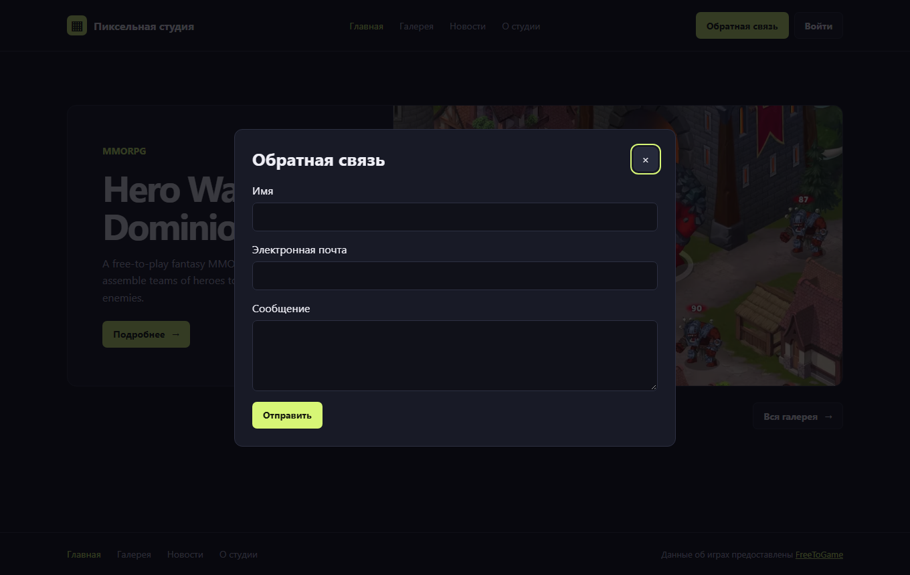
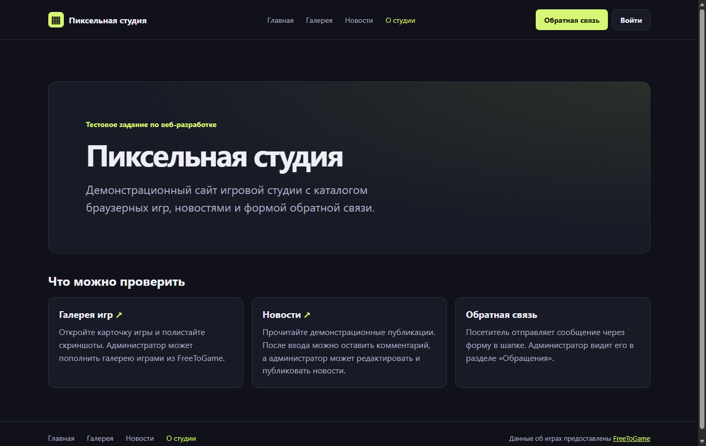
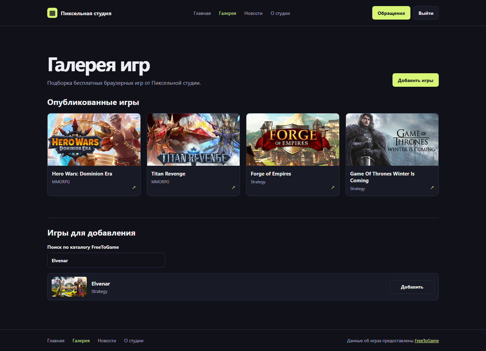
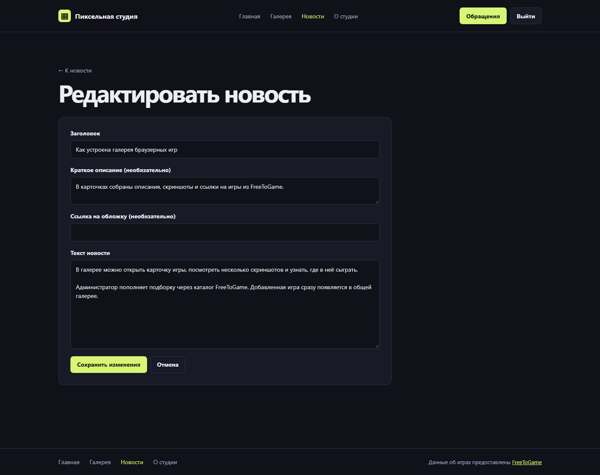
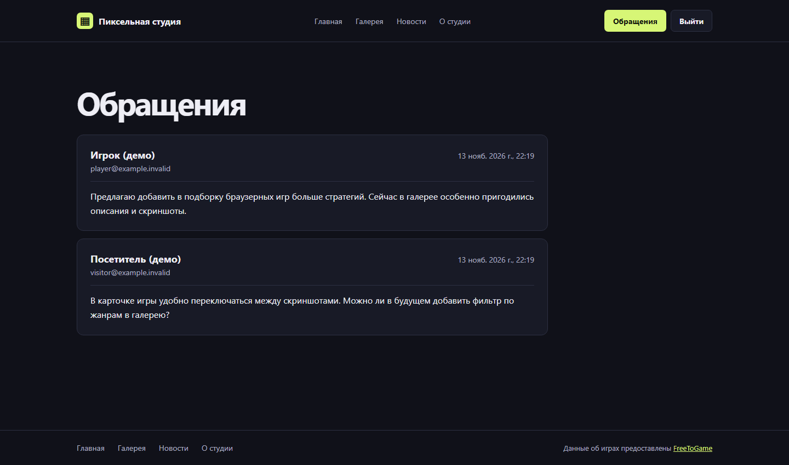

# Пиксельная студия

Учебный сайт игровой студии. React отображает страницы, Express обслуживает API, SQLite хранит игры, новости, комментарии и обращения.

## Скриншоты

### Главная

Витрина с последней добавленной игрой и переходом в полный каталог.



### Карточка игры

Самодельная карусель на React. Стрелки листают кадры по кругу, а миниатюры открывают выбранный скриншот.



### Новости

Из ленты можно открыть статью и прочитать комментарии. Отправка комментария доступна после входа.



<details>
<summary>Ещё страницы и обратная связь</summary>

**Галерея игр**



**Статья и комментарии**



**Форма обратной связи**



**О студии**



</details>

<details>
<summary>Интерфейс администратора</summary>

**Добавление игр из FreeToGame**



**Редактирование новости**



**Входящие обращения**



</details>

## Запуск

Понадобится Node.js 24. Создайте `.env` на основе `.env.example` и задайте пароли для учётных записей `admin` и `user`.

```sh
npm ci
npm run seed:demo
npm run dev
```

Откройте http://127.0.0.1:5173. Команда `seed:demo` необязательна. Она добавляет демонстрационные игры из FreeToGame и новости в локальную базу.

Чтобы проверить собранный фронтенд, выполните `npm run build` и `npm run preview`.

## Архитектура фронтенда

Код в `src` организован по [Feature-Sliced Design](https://feature-sliced.design/ru/docs/reference/layers).

- `app` запускает React, определяет маршруты и загружает сессию.
- `pages` собирает экраны сайта, а `widgets` содержит общий макет с шапкой и подвалом.
- `features` реализует действия пользователя, например импорт игры и отправку комментария.
- `entities` объединяет код игр, новостей и сессии, который используют несколько экранов.
- `shared` содержит HTTP-клиент и универсальное модальное окно.

Срезы импортируют код из нижних слоёв через публичные `index.js`. Например, страница галереи использует карточку из `entities/game` и импорт из `features/import-game`.
